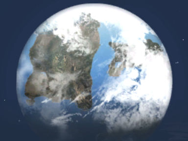

# Creation of Norrath

In the beginning, all that existed was void. Empty of all, whether it be time or space. A vast and endless nothingness cloaked in a deep and all consuming silence.

Within this void existed "The Nameless", a power so incredible that in the entire universe, it knew only itself to exist. It had no idea why it was there, just that that it was.

In the quiet expanse of the void, it sent itself out and searched the void to find something different. And there it was, a pocket of space and therein lay the flow of time.

When The Nameless stepped into the space, something terrible but wonderful, something terrifying but exciting happened. It detected the elements of space and time.

The Nameless, knowing nothing of these things, freed what was in there so it could spread out in all directions, filling the space that had been empty for so long with a force that had no boundaries.

Forces touched each other and the emptiness filled with swirling energies, light and heat touched emptiness. Energies collided and crashed, were born and died and became new and different... none of those having been seen ever before started to form planets that differed in size and structure. Also created were stars to watch over this new creation.

But the whole chaos needed order, shaping and fine touch. And so the Nameless created The Gods of Power.

To do so, The Nameless reached into the chaos, drew forth four equal portions of the stuff of existence and shaped it into the Gods that would divide the universe into form.

The first was named Rathe and got the task of bringing order into the chaos. It saw that the task was indeed immense, so it reached into itself and divided into 12 equal parts.

Then The Rathe went into the chaos divided some more material and created Earth. This Earth got set under the eyes of the Nameless, under the stars, so it could watch over his cosmos.

The second was named Fennin Ro and received the task of shaping the chaos.

Fennin as well drew his portion and named it Fire.

He then placed it upon the stars to shed light on the cosmos. Fennin Ro helped The Rathe to shape the solid matter and gave warmth to the cold of chaos.

The third was named Water and The Nameless determined it would need many forms.

So it took the portion and split it into three.

Tarew Marr would be responsible for the main state of the element, the Water, E'Ci for the solid state; the Ice and Povar would lord over steam. These three took their portion and cloaked each world with its life giving touch.

And finally the fourth was named Xegony and she received the task of drawing away the material in-between and setting each thing in its place.

She used her portion of chaos to make it into Air, which she used to blow the chaos away and cushion each world from the harshness of the cold cosmos.

The Nameless then looked into its new creation and felt sorrow because it could not experience it, for the creation could not contain the Nameless and so it decided to find a way to explore this new existence.

So the Nameless called out to the Gods of Power and commanded them to make minions that it could share in their experience of this new world.

Each of the Gods of Power reached into their elemental planes and drew forth a portion that they shaped with their will into what would be eyes and hands for The Nameless and themselves.

They created beings of energy, much like themselves, but beings of will born of the matter of the cosmos.

The Gods of Power knew that balance must be maintained in the universe to keep its shape.

Therefore they started to create the Gods of Influence in the model of a scale, on one side a force of darkness or destruction, on the other side a force of light or creation and ...in the middle, a neutral or balancing force to maintain the balance without the involvement of the Gods of Power.

And so they combined their elements to create each God in turn, good, neutral and evil, which the children of Norrath may choose to follow until the end of times.

{.align-center}

---
Source: Seeress Tiding - GM event

Comment:
In Everquest, sometimes GM would play a character and travel through Norrath, handing out cookies and milk to players and telling stories.