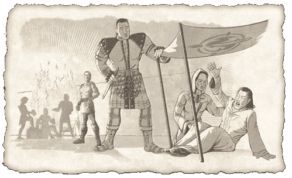

# A Path with Purpose
*Lost Dungeons of Norrath lore, Chapter 11*

The brilliance of the crimson light began to fade and a robed figured took an unsure step forward. Morden moved out of the shadows and was taken aback by the look of recognition on the mage's deeply creased face.

The mage extended a thin, trembling arm as his eyes began to roll back into their lids. The weakened man's knees gave way and he started to fall to the grimy floor of the sewer. Morden lunged forward with striking grace and speed, catching the mage before his head hammered the ground.

"Well, how do ye like that for a greetin'? I usually have to work a wee bit before folk fall to my feet," Morden cracked wise to Tondal.

"It is amazing to me how easily you amuse yourself, Morden," Tondal winked back.

The two collected the frail, shallow-breathing human and rested his back against the slippery wall. Morden looked him over.

"I believe this be 'im, eh?" Morden asked, looking to Tondal for confirmation.

"He certainly did seem to have issue with his faculties. I would guess it is Calliav Giniuar," Tondal replied.

"Go yeself back to Lavastorm and tell Nedaria to collect our friends and meet us in the Commonlands. There be an old swashbuckler there that will put us up for a while. We just simply can't take this poor soul to that infernal place," Morden said.

"We shall meet you there soon, friend. Be safe," Tondal hesitated a moment before he spoke again. "It may just be my excitement, but I think this meeting will be of great importance to all of us."

Morden looked at Tondal and nodded quietly.

"Aye, it may be."

Tondal turned and disappeared into the night outside the sewers.

---
*Source: Sony Online Entertainment, [original page](http://everquest.station.sony.com/lostdungeons/lore.jsp?page=LDON%20Lore%20Chapter%2011) ([archived copy](https://web.archive.org/web/20050303234710/http://everquest.station.sony.com/lostdungeons/lore.jsp?page=LDON%20Lore%20Chapter%2011), March 3, 2005). © Daybreak Game Company LLC.*

---
← [Chapter 10: Seeking the Stone](/lore/ldon/seeking-the-stone) | [Lore Guide](/lore/ldon) | [Chapter 12: An Adventurer’s Agreement](/lore/ldon/an-adventurers-agreement) →