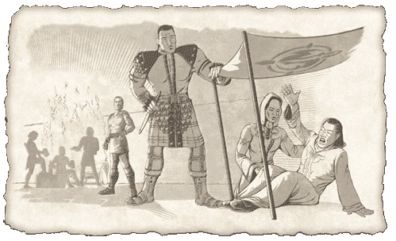

# Madman's Curse
*Lost Dungeons of Norrath lore, Chapter 9*

A withered form stumbled about the Plane of Knowledge, his feet dragging over the stone pathways.

The agony and confusion the wizard felt in his mind was embodied in his physical presence. His robe hung scruffily around his frame and the tattered hem whispered as it trailed across the cobbles. Strings of dark matted hair dangled around his face.

At intervals, the wretched man, Calliav Giniuar, had moments of clarity and spewed broken words and splintered visions with a wild look in his eyes.

"Time! My lord in Time. . . We fail . . . dark days . . . shadows move under Norrath . . . sands . . . a curse . . . the stone!" he cried madly.

Calliav learned the legends about Zebuxoruk, the Forsaken, when he was a small boy. As he grew older, his dreams and hopes that the demigod Zebuxoruk could be contacted and freed from his imprisonment in the Plane of Time became an obsession. Calliav's awe of the knowledge that Zebuxoruk was thought to have was unbounded.

Year after year, Calliav honed his meditative skills. He believed he could reach Zebuxoruk, who he called his "lord," through a focused and loyal mind.

After many years of practicing meditative arts, Calliav's mind was able to transcend his body and make contact with ethereal beings. Thus far, he had never been close to feeling or seeing Zebuxoruk.

Day after day, Calliav continued to refine his focus.

Zebuxoruk had felt Calliav's spirit some time ago and believed he might make an acceptable repository for some of his knowledge. Having been imprisoned in Time, Zebuxoruk felt a need to find a channel that would allow his grim visions of the future to reach the citizens of Norrath.

One fateful night, Calliav focused his mind with such great intensity that the rhythm of his heart almost ceased. His breaths were long and deep. In those moments, Calliav's presence was palpable to Zebuxoruk, so he unleashed a fraction of his knowledge to the determined mage's mind.

Calliav was sorely unprepared, as any mortal would have been, to receive such a flood of knowledge. His mind was blinded and unable to sort, comprehend, and process. He opened his eyes, attempting to focus on a stack of tomes in his dimly lit room and couldn't. Reality became clouded by the unfathomable number of thoughts flitting across his mind's eyes.

Calliav felt an urgency about the knowledge Zebuxoruk had given him. A need to prepare for danger grew in his heart. Something dark and terrible was on the horizon-something so foul it was almost inconceivable. Logic crumbled.

A vision of a magic stone pulsed inside Calliav. He had to learn what it meant. Had to.

His mind screamed as his body tried to command his feet to take him to the Plane of Knowledge for answers.

He fell against the door of his modest room in the West Karanas. Something ominous and evil prowled just beyond his vision, choking his mind. "Doom," he thought. "It could be the end of us all."

---
*Source: Sony Online Entertainment, [original page](http://everquest.station.sony.com/lostdungeons/lore.jsp?page=LDON%20Lore%20Chapter%209) ([archived copy](https://web.archive.org/web/20050303233345/http://everquest.station.sony.com/lostdungeons/lore.jsp?page=LDON%20Lore%20Chapter%209), March 3, 2005). © Daybreak Game Company LLC.*

---
← [Chapter 8: A Dragon’s Riches](/lore/ldon/a-dragons-riches) | [Lore Guide](/lore/ldon) | [Chapter 10: Seeking the Stone](/lore/ldon/seeking-the-stone) →