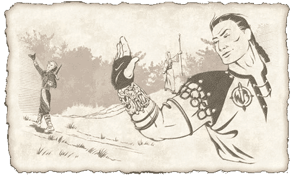

# Search for Lost Lands
*Lost Dungeons of Norrath lore, Chapter 13*

In the warm air of the Commonlands tunnel, Calliav closed his eyes and began running through the countless images and visions filling his mind.

"I see snow, ice, and a great magic with no face. There may have been a face once, but it is gone now," he whispered. "There is little more to that, I'm afraid."

Nedaria stood close and kept her hand on his forehead, helping him slow the rush of thoughts. Morden took notes in a code only the most trusted Wayfarers Brotherhood could understand.

"Now I see blood. Lots of blood. The dead are walking, breathing, reanimating. They are unholy and feed in the most despicable ways. I see a castle . . . but there is much underground. Much more," Calliav said.

There was a pause as Calliav searched his thoughts. Suddenly, he winced and his face lengthened.

"Confusion, fear. The walls are collapsing and sand is rushing in. Half blood, half sand. Now they are all in sand. They do not know that the wrath of Solusek Ro has passed," he said in low tones. His cheeks glistened with tears of sadness.

Calliav's chest heaved as he took a deep breath. He paused again. Under his eyelids, his eyes fluttered wildly.

The hush around them was broken as Calliav gasped so suddenly that air whistled through his teeth.

"Oh my, the paladins are lost. I see the frogloks blessed by Mithaniel Marr are transformed. A curse holds their souls. I feel the burning hate of a god," Calliav panted. "And the orcs. The orcs have risen. Goblins have been overrun and enslaved."

Morden and Tondal looked to Nedaria. In both of their eyes, Nedaria read the need for confirmation of Calliav's ramblings. In many ways, the possibility of undiscovered lands felt too good to be true. Morden also had trouble believing that he could have ever missed such places in his travels.

Nedaria looked at both of them and nodded.

"These visions he is sharing are not fantasy. They are real. There is much strife deep within the earth . . . and darkness," she said.

Morden turned around to see proud members of the Wayfarers Brotherhood sharing past adventurers and creating new stories as they ambled about. He cleared his throat.

"Listen up brothers and sisters. Our time has come. Pack your goods and be prepared to travel. Nedaria will lead a camp to the Frigid Planes and Northlands on Antonica. Tondal will lead some of our brethren across the Ocean of Tears to the Butcherblock Mountains on Faydwer," Morden said. "I will remain here with Calliav and a greater compliment of the Wayfarers Brotherhood. We are about to open the doors to the future of all Norrathians, I expect. Off with ye!"

<!-- TODO: add the in-game release date, e.g. *(Chapter released in-game on Month D, 2003)* -->

---
*Source: Sony Online Entertainment, [original page](http://everquest.station.sony.com/lostdungeons/lore.jsp?page=LDON%20Lore%20Chapter%2013) ([archived copy](https://web.archive.org/web/20050303234838/http://everquest.station.sony.com/lostdungeons/lore.jsp?page=LDON%20Lore%20Chapter%2013), March 3, 2005). © Daybreak Game Company LLC.*

---
← [Chapter 12: An Adventurer’s Agreement](/lore/ldon/an-adventurers-agreement) | [Lore Guide](/lore/ldon)