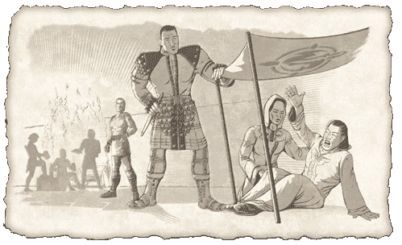

# Seeking the Stone
*Lost Dungeons of Norrath lore, Chapter 10*

Trapped in the chaos of his mind, Calliav continued to stagger through the Plane of Knowledge, aching for calm and relief for many days.

As he continually wandered, Calliav caught the murmurs of passing Norrathians. Several times, he heard about a band of adventurers, the Wayfarers Brotherhood, which had become well respected for its success in finding information and exploring.

It was clear to Calliav that he should seek the leader of this crew of explorers, Morden Rasp. He would send a messenger to request his help very soon. For now, though, Calliav had to continue his research into the vision of glowing stone that kept haunting him. He believed it to be that magical stone that was stolen from the trolls-the Grozmok Stone.

Morden, Nedaria, and Tondal had gotten word that a raving madman was seeking their assistance to find an object of grave importance. Naturally intrigued, Morden wanted to learn more, but was uneducated about travel to and from the planes. Twice now, he had sent messengers to get word to the lunatic, but had heard nothing more.

If the news about the madman was true, Morden and his friends might face their greatest adventure yet. The idea was an alluring proposition for another reason -- now that Morden's team of outcasts and shunned travelers rivaled any powerful group of explorers on Norrath, Morden wanted to prove the worth of his great friends to the world. He was confident they could take on any challenge and be successful. No one knew adversity like he and the rest of the Wayfarers Brotherhood.

Morden was told by the last messenger that Calliav could arrive on Norrath at any time and that he would most likely find his way to the city of Freeport.

Nedaria agreed to lead the growing camp in Lavastorm while Morden and Tondal ran to Freeport. Tondal was familiar with the underground labyrinth of the sewers of the city.

The two companions ran with the shadows in Nektulos forest, slipping past the guards in the Commonlands. Arriving in Freeport, Tondal led Morden to the hidden entrance to the Freeport sewers. As they crept through the darkness, they came upon a pedestal holding a book. It emitted a power that made the hair on the back of Morden's neck stand on end.

The two edged their way around a corner to observe this strange object pulsating with magic.

It wasn't long before a low hum stirred from the book on the pedestal. The sound had such a deep resonance that Morden's teeth chattered. Tondal felt his chest vibrate as he watched a puddle of slime ripple at his feet.

The two shared a confused glance when a crimson glow began to fill the slippery walls of the sewer.

---
*Source: Sony Online Entertainment, [original page](http://everquest.station.sony.com/lostdungeons/lore.jsp?page=LDON%20Lore%20Chapter%2010) ([archived copy](https://web.archive.org/web/20050303234542/http://everquest.station.sony.com/lostdungeons/lore.jsp?page=LDON%20Lore%20Chapter%2010), March 3, 2005). © Daybreak Game Company LLC.*

---
← [Chapter 9: Madman’s Curse](/lore/ldon/madmans-curse) | [Lore Guide](/lore/ldon) | [Chapter 11: A Path with Purpose](/lore/ldon/a-path-with-purpose) →