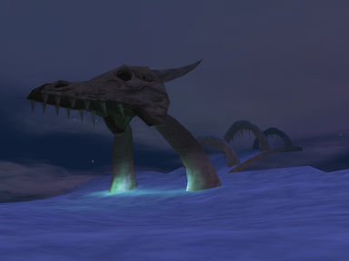
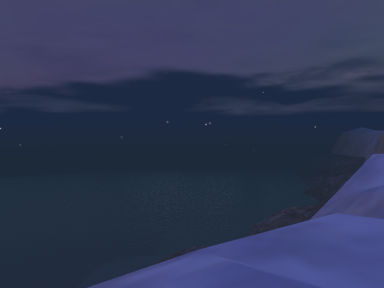

# History of Vellious

Before recorded time, Veeshan, the great Crystalline Dragon marked Norrath by striking the continent of Velious with her foreclaw, and deposited her brood there to dwell. The legends of that time also tell that Veeshan blasted Velious with her breath, encasing it in eternal ice and creating a barrier of deadly ice flows and stormy weather. This marked the beginning of the Age of Scale.

The Age of Scale lasted untold millennia. From the tidbits of information passed down, it is known that a group of dragons mastered magic and spellcasting during this era. Additionally, dragons of power and influence among their kind gathered together and formed a hereditary ruling council known as the Claws of Veeshan, who rule the dragons of Velious to this day. Few of Norrath?s inhabitants know more of this Age, and none that do would dare to speak.

The end of the Age of Scale was marked by the Gods creation of the other races of Norrath. Many of Veeshan?s vainglorious brood perceived that they might rule over these lesser beings and left Velious. This splinter group became known as the Ring of Scale. Those dragons that remained upon Velious had little interest in temporal power, and were content to pass the millennia in homage to their goddess, and in quiet contemplation and the study of magics.

In the Elder Age, the Ogres, Giants and Goblins conquered much of Norrath and began an assault on the Plane of Earth, precipitating retribution from The Rathe in the form of a great curse against all of Rallos Zek?s creations. The fertile homelands of the Giants (now known as Everfrost) were frozen, and those giants caught in the epicenter of the curse were transformed wholly into immortal creatures of living ice. Those nearby were struck to the core of their beings, becoming lesser creatures in mind and body than they had been. Those few who escaped the effects fled Tunaria for other lands, coming to the attention of Prexus the Oceanlord, who sent a great storm to destroy them. The storm drove many ships back to Tunaria and to Kunark, where the curse of The Rathe took hold to a lesser degree than in Everfrost. Many of the most powerful giants managed to escape the storm thanks to their great powers, and passed through the Frigid Barrier to land upon the Icy Fingers in Velious. The Kromrif established themselves in the Eastern Wastes and lived as nomads, eventually coming into conflict with the Coldain. The Kromzek were the most powerful of all Rallos Zek?s creations. Not content with a nomadic lifestyle, they established a mighty fortress city named Kael Drakkal in the Great Scar of Veeshan. The Claws of Veeshan took exception to the intrusion of the Kromzek upon their sacred lands, and thus began the long conflict between the two mightiest races on Norrath, in this most inhospitable of all places. Ages passed, leaving the eastern regions of Velious largely in the control of the Giants. It was during this time that the ships of the Coldain, or Ice Dwarves, were wrecked upon the ice of the Frigid Barrier. Those few who survived to reach the shore escaped the notice of the Claws of Veeshan, but were devastated in a conflict with the fearsome Kromrif. Fleeing the giants, the Coldain established Thurgadin, a hidden underground fortress in the mountains. Since these times, none of the other races of Norrath have dared to approach the Frigid Barrier, and thus Velious remained undiscovered.

In the present day, the Gnomes of Ak?anon have revealed an ocean vessel with the capability of navigating the roughest seas and breaking through ice flows. Upon it?s maiden voyage, the Gnomish Icebreaker successfully penetrated the Frigid Barrier and discovered the islands known as the Icy Fingers. Upon the largest of the islands, the crew discovered an ancient and massive bridge, which arced away into the mists and revealed the tip of a massive glacial continent - Velious! For a price, these Gnomes and their allies will offer the brave adventurers of Norrath passage to these frozen, uncharted lands.

You may be one of the first to explore this deadly and forbidding icy land. You feet may be the first tread its deadly caverns and ancient shrines. If you are among the stout of heart, you may dare to enter The Scars of Velious. You are in our world now!

  <figure style="margin:0; text-align:center; max-width:48%;">
    
    <figcaption>The Dragon Bridge in Iceclad - Velious</figcaption>
  </figure>
  <figure style="margin:0; text-align:center; max-width:48%;">
    
    <figcaption>The Iceclad Ocean - Velious</figcaption>
  </figure>

---

>Source:
>Everquest Manual 
>http://lorenorrath.free.fr/read.php?link=sov_history
{.is-info}